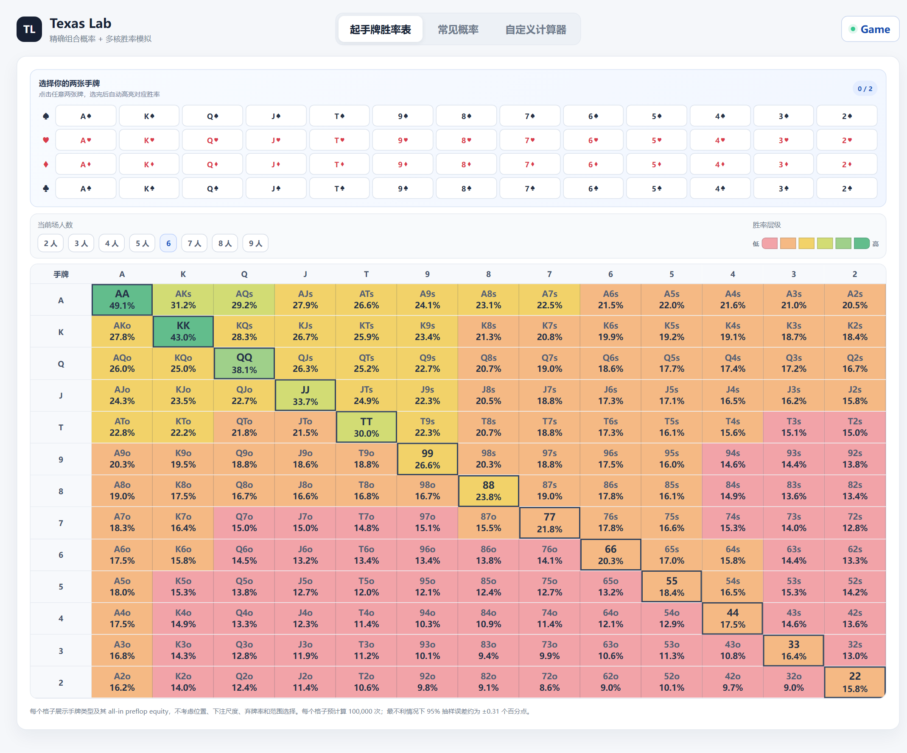
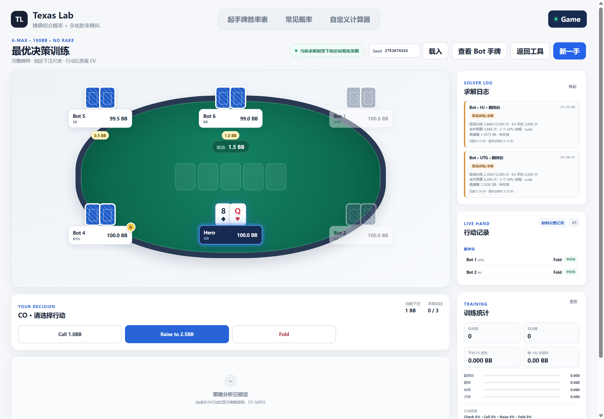
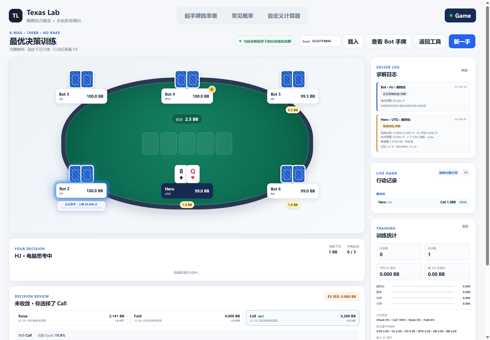

# Texas Lab

<p>
  <a href="https://github.com/HBZHSN/TexasLab/stargazers"></a>
  <a href="https://github.com/HBZHSN/TexasLab/network/members"></a>
  
  
  
  
</p>

Texas Lab 是一个面向学习与研究的德州扑克分析工具，包含两部分能力：

- **概率工具**：169 起手牌胜率矩阵、常见成牌概率、自定义牌面计算。浏览器端使用精确组合枚举与 Web Worker Monte Carlo。
- **六人桌训练模式**：100BB 无抽水 6-Max 牌局，通过 WebSocket 调用 Python 范围求解后端，在每次行动后给出策略频率、动作 EV、置信区间与决策复盘。

> 本项目用于算法、概率与工程实践研究，不构成任何赌博建议。请遵守所在地区法律法规。

<p align="center">
  
</p>

## 目录

- [功能特性](#功能特性)
- [项目截图](#项目截图)
- [快速开始](#快速开始)
- [技术栈](#技术栈)
- [系统架构](#系统架构)
- [游戏求解模型](#游戏求解模型)
- [离线 Blueprint 与价值模型](#离线-blueprint-与价值模型)
- [运行配置](#运行配置)
- [安全与质量门槛](#安全与质量门槛)
- [验证与测试](#验证与测试)
- [主要目录](#主要目录)
- [贡献](#贡献)
- [许可证](#许可证)

## 功能特性

- 169 类起手牌 all-in preflop equity 矩阵，支持 2 至 9 人桌。
- 公共牌成牌事件完整枚举，随机对手 equity 使用 Web Worker Monte Carlo。
- 可复现牌局种子、Bot 随机决策与完整行动导出。
- 6-Max 规则：位置、盲注、固定 Bet/Raise 尺度、全下、边池与摊牌结算。
- MCCFR/RM+ 范围加权反事实 EV 求解，支持 CPU 与 CUDA 批量牌型评估。
- Blueprint 精确节点、策略模型与叶价值模型的离线训练、校验、原子发布和运行时热加载。
- 求解请求隐私隔离：拒绝完整牌堆与任何对手底牌，公开行动历史使用字段白名单。
- 策略可靠性检查：根遗憾、未覆盖访问率、EV 置信区间与未收敛提示。
- 浏览器端零依赖运行，Python 服务只依赖 FastAPI、Uvicorn 与 NumPy。

## 项目截图

| 实时牌桌与行动选择 | 决策复盘与 EV 分析 |
| --- | --- |
|  |  |

## 快速开始

环境要求：

- Python 3.11+
- Node.js 20+（仅用于脚本、测试与静态资源服务）

```bash
git clone https://github.com/HBZHSN/TexasLab.git
cd TexasLab
python -m pip install -r requirements.txt
npm run serve
```

打开 `http://127.0.0.1:8000/`，点击右上角 **Game** 进入训练模式。如果 8000 端口被占用：

```powershell
$env:TEXAS_LAB_PORT = "8765"
npm run serve
```

Windows + NVIDIA GPU 可选安装 CUDA 12.8 版 PyTorch：

```powershell
python -m pip install -r requirements-gpu.txt
```

## 技术栈

| 层级 | 技术 |
| --- | --- |
| 前端 | 原生 HTML / CSS / JavaScript、Web Worker、WebSocket |
| 后端 | Python 3.11+、FastAPI、Uvicorn |
| 数值计算 | NumPy、CUDA PyTorch（可选） |
| 求解算法 | External-sampling MCCFR / RM+、范围 Bayes 更新、BluePrint 热启动 |
| 测试 | Node.js `node:test`、Python `unittest`、浏览器 CDP smoke test |
| 安全 | Gitleaks、字段白名单、产物指纹与原子发布 |

## 系统架构

```text
┌──────────────────────────────── Browser ────────────────────────────────┐
│  index.html + src/js/                                                   │
│    ├── 概率工具：精确组合枚举 + Web Worker Monte Carlo                  │
│    └── Game UI ── WebSocket /ws/game ───────────────┐                   │
└────────────────────────────────────────────────────┼───────────────────┘
                                                     ▼
┌──────────────────────────────── Python / FastAPI ──────────────────────┐
│  server.py                                                             │
│    ├── backend/schema.py        公开字段白名单与隐私隔离                │
│    ├── backend/belief.py        1326 组合范围 / blocker / Bayes         │
│    ├── backend/solver.py        MCCFR / RM+ 范围加权反事实 EV           │
│    ├── backend/blueprint.py     精确节点与策略模型 bundle               │
│    ├── backend/value_model.py   六席信念条件叶价值模型                  │
│    └── backend/depth_limit.py   安全深度截断与公共范围更新              │
└────────────────────────────────────────────────────────────────────────┘
```

前端只发送当前行动者底牌、公共牌、公开行动、筹码、底池和合法动作。Python 后端从公开行动建立范围先验，在完整后续行动树中训练所有玩家策略，并对最终 EV 进行配对统计与置信区间汇总。

## 游戏求解模型

- 前端只向后端发送当前行动者底牌、公共牌、公开行动、筹码、底池和合法动作。
- Python 后端拒绝包含完整牌堆或任一对手底牌的求解请求。
- 后端依据公开行动建立当前子博弈的范围先验，再从当前节点递归计算本街剩余行动、后续公共牌、后续下注、弃牌、全下、边池与摊牌。
- 求解器使用 external-sampling MCCFR/RM+ 和 Monte Carlo chance sampling 在同一棵完整后续行动树中训练所有玩家策略；每次 traversal 预先抽取一条公共牌 runout，使所有反事实动作共享同一 chance outcome。多人平均策略采用 simple averaging，当前 Hero 根节点另外保留线性加权平均；不使用翻牌前人工 EV 惩罚、EV softmax 频率或独立的启发式跟注响应。
- Hero 与电脑节点默认请求 20,000 次预算。普通 CUDA 与 CPU 路径默认最多使用 4 个训练进程，分别由 `TEXAS_LAB_GPU_TRAINING_WORKERS` 和 `TEXAS_LAB_CPU_TRAINING_WORKERS` 控制，并受逻辑核心数限制；翻牌前在单张 GPU 上默认只保留 2 个生产进程（`TEXAS_LAB_PREFLOP_GPU_TRAINING_WORKERS`），减少多个深树控制流争抢同一 CUDA 设备。存在已验证 Blueprint 策略时，每副本训练占比降为 45%、训练下限为 1,500 次；没有 Blueprint 时为 60% 和 3,000 次。多进程评估分片至少 500 次，因此合并后的实际预算可能高于请求值。
- Game 模式的 20,000 次现在是上限而非固定训练量。训练默认每 256 次检查一次 MCCFR 已经计算出的根动作累计反事实 EV；普通节点至少训练 1,500 次，全部动作 EV 的最大变化连续 2 次不超过决策误差预算后剪掉剩余批次。翻牌前使用 1,024 次下限，并增加决策导向剪枝：同一最佳动作连续领先、平均策略权重至少 70%，且领先幅度覆盖误差预算和最近 EV 漂移时，无需等待明显落后的 Call/Raise 自身完全稳定即可进入最终评估。检查过程不增加额外树遍历；明显领先的翻牌前决策把最终评估总量封顶为 2,000 次，接近决策仍保留原评估预算，多副本始终按相同样本数合并。可用 `TEXAS_LAB_ADAPTIVE_TRAINING=off` 恢复完整训练；`TEXAS_LAB_PREFLOP_TRAIN_MIN_ITERATIONS`、`TEXAS_LAB_TRAIN_DOMINANCE*`、`TEXAS_LAB_TRAIN_BEST_FREQUENCY` 和 `TEXAS_LAB_PREFLOP_DOMINATED_EVAL_TOTAL` 可调整翻牌前剪枝。
- 默认工程误差预算为决策尺度的 5%，由 `TEXAS_LAB_ERROR_BUDGET=0.05` 控制。决策差值尺度使用 `max(1BB, pot)`，单动作绝对误差尺度还会考虑 Hero 剩余筹码和累计投入。根平均遗憾容忍值、未覆盖策略访问率、顺序停止精度和明显优势阈值均由同一预算派生；它是实时训练的工程容忍度，不是六人桌 exploitability 或真实 GTO 误差保证。超出容忍度时策略仍标为“未收敛”，Bot 使用最高 EV 动作兜底。
- CUDA 训练以 64 个 traversal 为一个 mini-batch；CPU 路径保持逐 traversal 更新。公共行动历史使用紧凑路径 ID，信息集键只保留玩家、公共节点和牌力/牌面 bucket；每个求解副本缓存与具体公共牌无关的确定性下注转移。CPU 保留分支密集的行动树控制与信息集字典，所有终局叶节点先延迟收集，再由 CUDA 批量完成七张牌比较；GPU 结果回传后统一累加该批 RM+ 遗憾。最终范围 equity 与各动作 EV 的终局摊牌也走 CUDA 批处理，CPU 负责边池、配对差值、方差和置信区间汇总。没有 CUDA 时自动使用规范 Python 牌型计算器精确回退。
- CFR 的 traverser 顺序和线性平均权重保存在 `training_iteration` 中，可用 `train_chunk()` 连续增加预算而不重置训练日程；手牌与牌面桶使用确定性的 bit-packed 编码，不再依赖进程内发现顺序。评估终局直接在各生产进程内批量结算，避免把大量树叶对象序列化回主进程。
- 单进程 EV 评估默认每 128 个样本检查一次，至少评估 128 个共享 runout；动作均值与动作差值使用配对 Welford 统计。顺序停止采用有界效用的经验 Bernstein 半径，并把全局 `alpha=0.05` 分摊到全部重复检查、单动作区间和动作对区间；即使观测方差暂时为零也不会得到虚假的零半径。多进程不在各副本内部独立提前停止，而是强制每个副本使用相同样本数后再等权合并，避免难收敛策略因样本更多而错误改变目标 EV；合并结果使用固定样本经验 Bernstein 半径。模型参与截断时，按动作加入 artifact 的 P99/最大 uncertainty 预声明校准半径；该统计不是数学硬界。可用 `TEXAS_LAB_ADAPTIVE_EVALUATION=off` 关闭单进程顺序停止。
- EV rollout 优先使用精确信息集的已训练策略；精确桶没有任何策略样本时，才回退到同一玩家、同一完整下注路径下的牌力/听牌分层平均策略，最后才使用均匀策略。界面分别报告精确未训练率、分层策略回退率和仍需均匀回退的比例；分层回退不会覆盖已有精确策略。
- WebSocket 服务对“完整信息集与迭代预算都相同”的请求使用线程安全的进程内 LRU 缓存，并合并同时到达的重复求解；缓存键会把 24 种全局花色重命名归一到同一精确博弈，因此翻牌前相同位置、行动历史和同一 169 手牌类别可以跨花色复用，除此之外不做相似节点近似。默认保留 64 个节点，可通过 `TEXAS_LAB_SOLVE_CACHE_SIZE` 调整，设为 `0` 可关闭已完成结果缓存。
- Windows + NVIDIA GPU 可使用 `python -m pip install -r requirements-gpu.txt` 安装官方 CUDA 12.8 PyTorch wheel。界面与导出记录实际计算设备、GPU 手牌计算数和批次数，不会把 CPU 回退标成 GPU。
- 每次 Hero 行动后会按具体下注节点解释推荐动作：对比所选动作的 EV，并说明位置、手牌、范围 equity 与 Raise 的收益来源；解释也会保留在本手复盘中。
- 每次 Hero 和 Bot 行动都会保留完整 EV、策略频率、推荐动作与实际选择；“复制完整记录”会导出行动前底池、剩余与有效筹码、EV 置信区间和净输赢，牌局结束后还会附上全部玩家底牌供复盘。底牌只进入完成后的导出，不会暴露给求解器。
- 牌桌可切换查看所有 Bot 手牌，但该显示状态不会进入求解信息集；每手牌的种子可见并可重新载入，以复现发牌与 Bot 的随机决策。
- 当前游戏只提供一个固定 Bet/Raise 尺度且每街最多三次加注，因此结果是这个离散下注子博弈的 MCCFR/RM+ 近似策略，不是无抽象六人桌无限注德州的数学精确 GTO。遗憾、未训练访问率或置信区间过大时界面显示“未收敛”，不会给出确定性评级。

## 离线 Blueprint 与价值模型

仓库提供一条可复现的离线 Teacher 数据、portable 模型和 Blueprint bundle 流水线。输入文件是 JSONL 或 JSONL.GZ，每行可以直接是一个完整 `info`，也可以是 `{ "info": { ... } }`。`collect` 会强制关闭当前 Blueprint，并使用完整 MCCFR 求解器产生 Teacher 标签，避免模型用自己的输出重新训练自己。

### 常见慢节点的一键训练

固定 100BB 六人桌最慢且访问最频繁的是翻牌前。以下命令会按公开行动路径的估计访问概率选择 192 个高频状态，并为每个状态覆盖完整 169 类起手牌，共 32,448 个精确节点；当前流量先验下约覆盖 85.8% 的翻牌前决策访问。任务逐节点持久化、可安全中断并用同一命令恢复；首个 169 节点批次完成后即发布，随后每完成 507 个节点重新训练和原子发布一次 Blueprint：

```powershell
python scripts/train-common-blueprint.py
```

在测试机上，相同 20,000 次固定预算下，10 路纯 CPU 与 10 路 CUDA 的吞吐差距很小；CUDA 路径仍受 CPU 树遍历控制流限制，却额外占用显存和功耗。因此一键任务默认采用 10 路纯 CPU。可用 `--workers` 和 `--device cpu|cuda` 显式覆盖。

正式产物固定发布到 `artifacts/blueprint-production.json.gz`。直接用 `python server.py` 或 `npm run serve` 启动时，服务会在 `auto` 模式下自动热加载该路径；产物尚未通过质量门槛、文件损坏或版本不兼容时继续走完整在线求解。该训练任务只声明支持 `preflop`，不会把翻牌前网络用于翻牌后节点。进度和错误记录在 `logs/common-blueprint.log`。

```powershell
python scripts/train-blueprint.py collect `
  --input data/training-nodes.jsonl `
  --dataset artifacts/teacher-v1.jsonl.gz `
  --iterations 20000 `
  --seed 20260731 `
  --regret-mode rmplus `
  --append

python scripts/train-blueprint.py train `
  --dataset artifacts/teacher-v1.jsonl.gz `
  --output artifacts/blueprint-v1.json.gz `
  --base-bundle artifacts/blueprint-previous.json.gz `
  --engine auto `
  --device auto `
  --epochs 600

python scripts/train-blueprint.py inspect artifacts/blueprint-v1.json.gz
```

`--engine auto` 在 PyTorch 可用时训练小型 Dense/ReLU 网络，否则使用无需额外依赖的纯 Python 线性训练器。两种训练器都导出普通 JSON 权重；服务端优先用 NumPy `float32` 批量推理，无 NumPy 时保留等价的纯 Python 回退，不要求安装 Torch，也不加载 pickle。Teacher 数据生成会调用当前完整求解器，成本远高于模型训练，建议先用少量跨四街节点验证流程，再逐步扩大数据集。不要在数据生成外层再启动一层求解进程池。

训练产物包含：按稳定公共信息集键保存的高预算精确结果、行动者策略模型，以及行动者根状态价值模型。键会先过滤 UI/复盘字段，再对 24 种全局花色重命名做 canonicalization；规则、特征和抽象版本均进入 bundle 指纹。范围的运行时契约仍是每席 1326 个具体两张牌组合：新公共牌出现后执行 blocker 条件化，并用行动似然执行 Bayes 更新；已弃牌玩家的隐藏范围仍参与完整隐藏牌分配的物理卡牌阻断，但不会被当作活跃摊牌玩家。

Blueprint bundle 中的 `valueModel` 是“当前行动者根状态价值”，只用于诊断，不能冒充树内叶值。在线求解会直接复用 bundle 中预算足够的精确节点；其余节点用通过验证的 `policyModel` 给新信息集做可衰减的遗憾/平均策略热启动，强度由 `TEXAS_LAB_BLUEPRINT_PRIOR_WEIGHT` 控制。

真正的叶模型使用独立 artifact，输入公共状态、六席各 1326 手牌边际范围和六席 continuation profile，按指定 seat/hand 输出条件终局筹码及 uncertainty。当前特征契约为 `public-belief-six-seat-range169-v2`：每席保留完整的 169 类起手牌概率分布，并附带 entropy、ESS、支持组合数、点数/花色、对子/同花、高牌和 gap 等诊断特征，总输入维度为 1515；它不是把范围压成单一 equity。先把真实全范围 Teacher 目标规范化，再训练：

```powershell
python scripts/generate-leaf-data.py data/leaf-teacher-000.jsonl `
  --output artifacts/leaf-shard-000.jsonl.gz `
  --teacher-version cfv-teacher-v1 `
  --blueprint-version <blueprint-fingerprint>

python scripts/train-leaf-model.py artifacts/leaf-shard-*.jsonl.gz `
  --output-dir artifacts/leaf-candidate `
  --device auto

python scripts/validate-artifacts.py `
  --holdout data/leaf-holdout.jsonl.gz `
  --blueprint artifacts/blueprint-v1.json.gz `
  --leaf-manifest artifacts/leaf-candidate/manifest.json `
  --output artifacts/leaf-integration-metrics.json `
  --publish-output-dir artifacts/leaf-v1
```

生成器只接受完整的六席条件终局筹码、Teacher 标准误和样本计数，不会把现有单 Hero 根 EV 伪装成反事实价值标签。训练器拒绝混合 Blueprint 或 Teacher 版本的数据，并且无论单模型指标多好都只写出不可生产启用的 candidate。校验器会在系统临时目录复制相同权重，签发随机、单次 A/B token，并只在 `ab` 模式下短暂加载；常规 `auto`/`required` 模式始终拒绝 candidate。

生产 A/B 配置固定为每节点 20,000 次 RM+、5% 误差预算、关闭自适应提前停止、Blueprint prior 16、叶信念每 64 次刷新、`auto` 截断且不显式指定深度，六席 continuation 均为 `blueprint`。所有 holdout 行都参与评估，显著动作按决策尺度的 5% gap 判定；IID 激活率和 OOD 回退都以实际 evaluation cutoff hit 计数，零次命中不能发布。验证还会核对活动 Blueprint 及其指纹与叶模型实际指纹。

全部门槛通过后才原子发布最终 artifact。`leaf-production-validator-v4` attestation 绑定候选 payload、Blueprint 指纹、Teacher 版本、holdout SHA-256、验证器版本、生产 solver/cutoff/continuation/validation 配置、continuation profiles 哈希和 metrics 哈希；运行时 manifest 指纹包含该审批信息，因此替换审批或模型都会使缓存与进程池配置失效。标为 `expectLeafFallback: true` 的 holdout 节点用于测 OOD 回退召回率。

在线搜索在翻牌前根到 Flop、以及三人以上 Flop 到 Turn/本街第二次 Raise 的边界尝试截断；Turn、River 和单挑 Flop 默认仍解到终局。每次截断前都会更新公开行动下的 Bayes 范围，检查 Blueprint 版本、street、存活人数、筹码/底池分布、范围 entropy/ESS/支持组合数和预测 uncertainty。任一检查失败立即继续完整树。同一冻结信念周期内，相同公开状态的 OOD gate 和相同 seat/hand 的网络预测会缓存复用；信念刷新时两类缓存同时清空，避免用旧范围污染新 CFR 策略。

## 运行配置

```powershell
$env:TEXAS_LAB_BLUEPRINT_PATH = "artifacts/blueprint-v1.json.gz"
$env:TEXAS_LAB_BLUEPRINT_MODE = "auto"      # auto | off | required
$env:TEXAS_LAB_LEAF_MODEL_MANIFEST = "artifacts/leaf-v1/manifest.json"
$env:TEXAS_LAB_LEAF_MODEL_MODE = "auto"      # auto | off | required
npm run serve
```

- `TEXAS_LAB_BLUEPRINT_PATH`：JSON/JSON.GZ bundle 的路径；未设置时继续使用完整在线求解。
- `TEXAS_LAB_BLUEPRINT_MODE=auto`：缺失、损坏、指纹不符或版本不兼容时安全回退；这是默认值。
- `TEXAS_LAB_BLUEPRINT_MODE=off`：完全禁用 Blueprint，适合生成 Teacher 数据和做基线对照。
- `TEXAS_LAB_BLUEPRINT_MODE=required`：产物不可用时直接报错，适合部署验收，避免静默使用错误版本。
- `TEXAS_LAB_BLUEPRINT_PRIOR_WEIGHT`：通过验证的策略模型对新信息集的伪样本强度，默认 16；训练增加后影响自然衰减。
- `TEXAS_LAB_REGRET_MODE=rmplus|linear`：在线实时求解和离线 Blueprint Teacher 默认使用 RM+；Linear CFR 可显式用于实验，并保持跨 `train_chunk()` 的全局迭代权重。
- `TEXAS_LAB_ADAPTIVE_TRAINING=true|false`：在线 Game 求解默认根据根动作 EV 的连续稳定检查提前结束；离线 Teacher 和生产 artifact A/B 验证会强制关闭，保证固定预算标签可复现。
- `TEXAS_LAB_ERROR_BUDGET`：统一的相对工程误差预算，默认 `0.05`，运行时限制在 `0.001` 至 `0.25`。未显式设置的根遗憾、动作差值精度、单动作绝对精度和明显优势阈值均由它及当前底池/筹码尺度派生。
- `TEXAS_LAB_LEAF_MODEL_MANIFEST` / `TEXAS_LAB_LEAF_MODEL_MODE`：独立叶模型 manifest 与加载策略。未获批模型在 `auto` 下保持关闭，在 `required` 下直接报错，不存在绕过质量门槛的生产开关。
- `TEXAS_LAB_LEAF_CUTOFF_MODE=auto|off|aggressive`：默认只使用保守街道边界；`aggressive` 仍受 artifact OOD 与 uncertainty 门槛约束。`TEXAS_LAB_LEAF_DEPTH` 可显式指定实验深度；`TEXAS_LAB_LEAF_CONTINUATIONS` 可按六席给出逗号分隔的 `blueprint`、`fold-x5`、`call-x5` 或 `raise-x5`，默认全部为 `blueprint`。
- `TEXAS_LAB_LEAF_BELIEF_REFRESH`：训练时每隔多少 traversal 刷新叶节点公共信念，默认 64；缩短间隔提高时效但增加 Bayes 范围更新成本。
- `TEXAS_LAB_EVAL_CHUNK_SIZE` / `TEXAS_LAB_EVAL_MIN_SAMPLES`：单进程顺序评估的检查批次和最少共享 runout，默认均为 128。`TEXAS_LAB_EVAL_ALPHA` 默认 `0.05`，会保守分摊到重复检查、单动作区间和动作对区间；自适应路径使用经验 Bernstein 界，多进程固定等样本路径使用 pooled fixed-sample Bernstein 界。`TEXAS_LAB_EVAL_TARGET_CI` 与 `TEXAS_LAB_EVAL_MATERIAL_EDGE` 默认留空并从 5% 误差预算派生。`TEXAS_LAB_EVAL_SEQUENTIAL_Z=2.58` 仅用于没有有界范围时的兼容回退；单进程关闭自适应后最终区间使用固定样本正态半径。
- `TEXAS_LAB_CPU_TRAINING_WORKERS` / `TEXAS_LAB_GPU_TRAINING_WORKERS`：分别控制 CPU 与 CUDA 训练进程上限，默认均为 4，并受逻辑核心数限制；两者和上述关键环境变量都会进入运行配置签名。
- `TEXAS_LAB_SOLVE_CACHE_SIZE`：控制精确结果 LRU，默认 64。Blueprint、叶模型、审批 manifest、CPU sequential/CUDA minibatch 执行语义和有效 batch size 都属于求解缓存/进程池签名；产物、设备路径或关键配置变化后不会复用旧结果。

## 安全与质量门槛

Bundle 使用 schema、特征版本、抽象版本、规则哈希和内容指纹共同校验，并通过临时文件加原子替换发布。服务端只接受 JSON 数值权重，不执行模型文件中的代码。求解请求的历史记录使用公开字段白名单；`deck`、`hole`、`holes`、`heroCards` 即使嵌套在复盘对象中也会被拒绝，UI 的 `review` 和 `context` 不进入稳定键或离线数据。

仓库本身不提交训练数据、日志、模型产物或本地缓存；这些路径由 `.gitignore` 排除，并使用 [Gitleaks](https://github.com/gitleaks/gitleaks) 在提交前检查敏感信息。

`train` 默认仅在下列冻结验证集门槛全部满足时把 bundle 标为 `validated`：

- 验证样本至少 100 个；
- 策略 Top Action 准确率至少 95%；
- 策略概率中位 L1 误差不超过 0.10（等价于总变差距离不超过 5%）；
- 诊断用状态价值 MAE 不超过 0.50BB，P99 绝对误差不超过 2.50BB。

这些阈值可通过训练命令参数调整，但降低阈值不等于模型获得更高可信度。数据集应覆盖四条街、不同位置、SPR、玩家数、牌面纹理和下注路径，并与未参与训练的高预算 MCCFR Teacher 对照。`inspect` 只负责结构、指纹和 manifest 检查；是否适合正式决策仍应结合独立策略一致率、价值误差、延迟 P50/P95 和固定节点回归判断。多人扑克没有可由这些指标替代的精确 exploitability 保证。

叶模型当前发布门槛为：至少 5k 个 held-out seat/hand 目标和 250 个公共状态；MAE ≤ 0.50BB、P99 绝对误差 ≤ 2.50BB、95% 区间覆盖率 ≥ 90%、平均 uncertainty ≤ 1.00BB、最大分组 MAE ≤ 1.00BB；至少 500 个显著节点，最佳动作一致率 ≥ 95%，策略 L1 中位数 ≤ 0.10、P95 ≤ 0.15，动作 EV 相对误差 P95 ≤ 5%；OOD 回退召回率 ≥ 95%，并且至少 250 个节点实际触发叶值、IID 叶激活率 ≥ 95%。最终动作的 `ci95` 是采样半径与逐动作 P99/uncertainty 校准半径之和；动作差值按双方校准半径保守累计，不会把模型风险藏在普通采样误差里，也不把 P99 误称为数学硬界。

## 验证与测试

```powershell
npm run verify
npm run smoke
npm run gpu-smoke
```

`verify` 覆盖牌型、组合概率、牌局状态机、信息隔离、公开历史白名单、花色同构稳定键、1326 组合范围 Bayes/blocker 更新与 169 类 v2 特征、portable DenseNetwork、Blueprint 原子发布与损坏回退、叶模型 candidate 隔离/A-B token/审批 attestation、共享公共牌 runout、CPU/GPU 张量牌型一致性，以及 batch-size=1 时 GPU 叶节点训练与顺序 RM+ 的一致性。

只验证离线基础设施时可运行：

```powershell
python -m unittest tests/test_schema.py tests/test_belief.py tests/test_blueprint.py
```

运行敏感信息扫描：

```powershell
gitleaks dir . --config .gitleaks.toml --redact
```

`smoke` 需要本机 Chrome 或 Edge，以及已经启动的 Python 服务；它会实际建立 WebSocket、运行一个 Hero 决策节点，并检查桌面和移动端布局。浏览器 sandbox 默认保持开启；只有已经由操作系统隔离、且 Chrome 子进程因权限错误无法启动的 CI runner 才应临时设置 `TEXAS_LAB_CHROME_NO_SANDBOX=1`。`gpu-smoke` 会直接运行完整 20,000 次 GPU 训练叶节点与 EV 评估，因此耗时较长；没有真实 CUDA 执行时会失败。

## 主要目录

```text
server.py                         FastAPI 静态服务与 WebSocket 入口
backend/poker.py                 Python 牌型评估
backend/solver.py                范围加权反事实 EV 求解
backend/schema.py                求解请求公开字段与隐私隔离
backend/abstraction.py           花色同构公共状态键与规则版本
backend/belief.py                1326 组合范围、blocker 与 Bayes 更新
backend/blueprint.py             Portable 模型、bundle 校验与运行时加载
backend/value_model.py           六席信念条件叶值 schema、模型与质量门槛
backend/leaf_runtime.py           叶模型热加载、指纹与失败关闭
backend/depth_limit.py           公共范围 Bayes 更新与安全深度截断
backend/online_stats.py          配对 Welford 统计与顺序停止
scripts/train-blueprint.py       离线 Teacher 收集、训练和产物检查
scripts/generate-leaf-data.py    全范围叶值 Teacher shard 规范化
scripts/train-leaf-model.py      异方差叶价值模型训练与 artifact 发布
scripts/validate-artifacts.py    完整树/叶模型 holdout A/B 与最终发布
src/js/game/game-engine.js       六人桌规则、下注、边池和结算
src/js/game/game-ui.js           实时牌桌、分析、复盘和统计
src/js/services/game-socket.js   WebSocket 请求管理
src/js/core/                     浏览器端牌与概率核心
tests/                           JavaScript 与 Python 回归测试
docs/screenshots/                README 项目截图
```

## 贡献

欢迎提交 Issue 与 Pull Request。提交前请确保：

1. `npm run verify` 通过；
2. 不提交 `artifacts/`、`data/`、`logs/`、模型文件或任何密钥；
3. `gitleaks dir . --config .gitleaks.toml --redact` 无告警；
4. 新增求解或模型逻辑时同步补充测试与质量门槛说明。

## 许可证

本项目基于 [MIT License](LICENSE) 开源。

## 免责声明

Texas Lab 是概率计算与强化学习/博弈论算法的工程实践项目。求解结果是特定离散下注子博弈的近似策略，不保证真实牌局收益，也不构成任何形式的投注或赌博建议。使用者应自行承担合规与风险责任。
